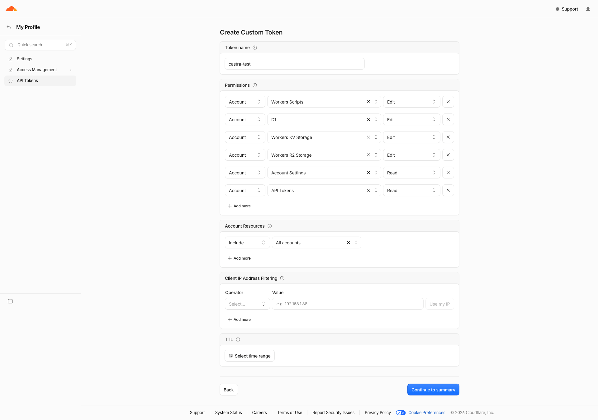

# Cloudflare API token for Castra

`castra provision`, `castra doctor`, `castra migrate --remote` and `castra deploy` read the token from
`CLOUDFLARE_API_TOKEN`. Set `CLOUDFLARE_ACCOUNT_ID` too unless the token can see exactly one account.
Never commit the token; in CI store it as a secret.

## Minimum permissions

Create a **Custom token** (dashboard → My Profile → API Tokens → Create Token → Create Custom Token, or an
account-owned token under Manage Account → Account API Tokens). Scope every row to the one account you deploy to.



In **Account Resources** pick `Include → <your account>`, not `All accounts` as in the screenshot. With
`All accounts` the token sees every account you belong to, and the CLI stops with `multiple-accounts` until
`CLOUDFLARE_ACCOUNT_ID` is set. The last two rows (Account Settings Read, API Tokens Read) are optional, see below.

### Which kind of token

The prefix tells you what you copied ([token formats](https://developers.cloudflare.com/fundamentals/api/get-started/token-formats/)):

| Prefix | Kind | Where it is created | Use with Castra |
| --- | --- | --- | --- |
| `cfut_` | User API token | My Profile → API Tokens | Yes. `CLOUDFLARE_ACCOUNT_ID` only if it sees more than one account. |
| `cfat_` | Account API token | Manage Account → API Tokens | Yes, but `CLOUDFLARE_ACCOUNT_ID` is **required**: Cloudflare verifies it per account. |
| `cfk_` | Global API Key | My Profile → API Tokens → Global API Key | No. Full account access; the CLI refuses it. |

Tokens created before the prefixed format are 40 plain characters and still work.

| Scope | Permission group | Level | Needed for |
| --- | --- | --- | --- |
| Account | **Workers Scripts** | Edit | `wrangler deploy`, `wrangler secret put`, listing secrets, workers.dev subdomain |
| Account | **D1** | Edit | find/create the database, `wrangler d1 migrations apply --remote`, deploy drift check |
| Account | **Workers KV Storage** | Edit | find/create the `CACHE` namespace |
| Account | **Workers R2 Storage** | Edit | only with storage enabled (`--storage` or `r2_buckets` in `wrangler.jsonc`) |

The API lists the Edit level under two names, e.g. "D1 Edit" and "D1 Write"; either works. `castra doctor` accepts
both.

Optional:
- **Account Settings Read** (Account): not required by Castra. Set `CLOUDFLARE_ACCOUNT_ID` instead; without it the
  CLI calls `GET /accounts` to find the single account the token can see. The API reference for that endpoint
  does not state a required permission, so if account discovery fails, set the variable.
- **API Tokens Read** (User, or Account for account-owned tokens): lets `castra doctor` read the token's own
  policies and tell Read from Edit precisely (ADR 0033). Without it, doctor reports `readable` for permissions it can
  only confirm at the Read level.

Not needed: zone permissions (Castra deploys to `*.workers.dev`; custom domains/routes need "Workers Routes Edit"
on the zone, which Castra does not configure).

## Checking a token

```
export CLOUDFLARE_API_TOKEN=...      # never commit this
export CLOUDFLARE_ACCOUNT_ID=...     # dashboard → Workers & Pages → Account ID
npx castra doctor
```

Doctor only sends `GET` requests. It verifies the token (`/user/tokens/verify`, or
`/accounts/{id}/tokens/verify` for account-owned tokens), probes each permission with a read-only list call, and
prints `Check | Status | How to fix`. Exit code 1 means something required is missing.

A refused probe (401/403) is always `missing`. If the token can read its own policies ("API Tokens Read"), doctor
then tells Edit from Read, counting only policies whose resources cover the target account
(`com.cloudflare.api.account.<id>` or `com.cloudflare.api.account.*`) and removing groups that a deny policy on
that account lists (ADR 0033, amendment 2026-10-11).

## Sources (verified 2026-10-10)

- Permission group names: https://developers.cloudflare.com/fundamentals/api/reference/permissions/
  ("Workers Scripts Read/Edit/Write", "D1 Read/Edit/Write", "Workers KV Storage Read/Edit/Write",
  "Workers R2 Storage Read/Edit/Write", "Account Settings Read", user-scoped "Memberships", "User Details").
- Token verify (user): https://developers.cloudflare.com/api/resources/user/subresources/tokens/methods/verify/
- Token verify (account-owned): https://developers.cloudflare.com/api/resources/accounts/subresources/tokens/methods/verify/
- Token details / policies ("API Tokens Read"): https://developers.cloudflare.com/api/resources/user/subresources/tokens/methods/get/
- Token policy `resources` keys and deny-before-allow evaluation (checked 2026-10-11):
  https://developers.cloudflare.com/fundamentals/api/how-to/create-via-api/
- D1 list/create/query ("D1 Read" or "D1 Write"):
  https://developers.cloudflare.com/api/resources/d1/subresources/database/methods/list/,
  https://developers.cloudflare.com/api/resources/d1/subresources/database/methods/create/,
  https://developers.cloudflare.com/api/resources/d1/subresources/database/methods/query/
- KV namespaces ("Workers KV Storage Read/Write"; create body `{ "title" }`, 400 on a duplicate title):
  https://developers.cloudflare.com/api/resources/kv/subresources/namespaces/methods/list/,
  https://developers.cloudflare.com/api/resources/kv/subresources/namespaces/methods/create/
- R2 buckets ("Workers R2 Storage Write" to create; body `{ "name" }`):
  https://developers.cloudflare.com/api/resources/r2/subresources/buckets/methods/list/,
  https://developers.cloudflare.com/api/resources/r2/subresources/buckets/methods/create/
- Worker secrets list ("Workers Scripts Read/Write"): https://developers.cloudflare.com/api/resources/workers/subresources/scripts/subresources/secrets/methods/list/
- workers.dev subdomain ("Workers Scripts Read/Write"): https://developers.cloudflare.com/api/resources/workers/subresources/subdomains/methods/get/
- Account-owned tokens: https://developers.cloudflare.com/fundamentals/api/get-started/account-owned-tokens/
- Wrangler behaviour (`secret put` from stdin, draft Worker creation, `deploy --secrets-file`,
  `d1 migrations apply --local/--remote`, non-interactive confirmation skip): wrangler 4.149.0 `--help` output and
  `wrangler-dist/cli.js`, see ADR 0032 and ADR 0034.

The account list endpoint (https://developers.cloudflare.com/api/resources/accounts/methods/list/) documents no
permission requirement. All calls are covered by mocked tests. A real-account `castra deploy` of a project scaffolded
with `create-castra` was verified on 2026-10-11 (user token, D1 + KV provisioned, migrations applied, Worker live on
`workers.dev`).
